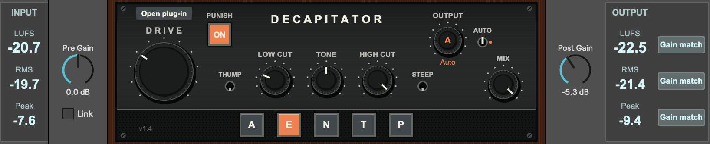

# M4L Wrappers

Control Soundtoys Decapitator, Wavesfactory Spectre and Sonnox Oxford Inflator from Ableton Live’s Device View. Each wrapper adds Pre Gain and Post Gain controls, input and output meters, and one-click gain matching by short-term LUFS, RMS or sample peak.

Each v1.4 download contains a single `.amxd`. Install the corresponding licensed VST3 plug-in and open the wrapper in Live with Max for Live. The devices support macOS (Apple Silicon and Intel), with beta support for Windows x64.

## Spectre Wrapper

Drag five colour-coded bands to shape saturation by frequency. Each band has its own saturation type and channel selection.

[Download on Gumroad](https://stephanterning.gumroad.com/l/m4l-spectre-wrapper) · [View on maxforlive.com](https://maxforlive.com/library/device/17391/spectre-wrapper)


## Oxford Inflator Wrapper

Adjust Input, Effect, Curve and Output, and switch Clip 0 dB, Band Split and Effect In directly from the device panel.

[Download on Gumroad](https://stephanterning.gumroad.com/l/m4l-oxfird-inflator-wrapper) · [View on maxforlive.com](https://maxforlive.com/library/device/17392/oxford-inflator-wrapper)


## Decapitator Wrapper

Choose among five saturation styles, push Drive or engage Punish, then shape the sound with the filters and Tone control. Use Mix to blend the processed signal with the dry input.

[Download on Gumroad](https://stephanterning.gumroad.com/l/m4l-decapitator-wrapper) · [View on maxforlive.com](https://maxforlive.com/library/device.php?id=17424)



## How the wrappers work

On macOS, install the VST3 in a standard folder such as `/Library/Audio/Plug-Ins/VST3`. Spectre in a folder selected only in Live can appear in Live’s browser while the wrapper passes dry audio. All three devices ask Max’s `vst~` to find the installed VST3 by name. Oxford and Spectre also process the audio in `vst~`. The macOS v2 Decapitator opens the exact bundle Max found in a small Steinberg SDK host. It verifies the class and parameter IDs. The Max lookup instance stays loaded with processing disabled while the SDK host processes the audio. The wrapper stores each instance’s preset in the Live Set. If loading fails, the wrapper lists the affected tracks and passes the original stereo input through at unity gain. After restoring the VST3 installation, click **Retry** on each affected device to reload its saved settings.

In the v2 devices, enable Live’s MIDI Map Mode and select the center of a Decapitator dial, an Oxford fader, or one of the three dials in Spectre’s inspector. Select the desired Spectre band or Global page before mapping. The assignment belongs to that parameter when you change pages.

The source build uses embedded Max `gen~` patches for the 5 ms gain ramps and the three-second stereo meters. Max generates the audio code on the user’s machine. Oxford and Spectre use the same device file on macOS and Windows. The macOS Decapitator development file contains an Apple Silicon and Intel host. Windows verification for this host is pending. The published v1.4 downloads used a compiled gain and meter external.

A Max for Live license supports playback of devices with embedded Gen. Editing and saving the Gen patch in the Max editor requires a standalone Max license. [Cycling ’74 on Max for Live licensing](https://docs.cycling74.com/userguide/m4l/live_limitations/)

## Build from source

Run this command from the repository root with Python 3.9 or later. On macOS it builds all three development devices in `dist/v2/`. The Decapitator build needs Xcode Command Line Tools, the Steinberg VST3 SDK and the Max SDK base. Place the SDKs in `deps/vst3sdk` and `deps/max-sdk-base`, or set `VST3_SDK` and `MAX_SDK_BASE` to their root directories.

```sh
python3 build.py
```

The v2 development devices are named **Decapitator Wrapper V2**, **Oxford Inflator Wrapper V2** and **Spectre Wrapper V2**. Keep the original Wrapper files at their existing paths for older Sets. Insert a Wrapper V2 device to start a new v2 instance. Below Pre Gain, **Compensate output** adds the opposite of Pre Gain after the plugin. Below Post Gain, **Output compensation** shows this adjustment in dB, or zero when off. Post Gain remains independently automatable. With Pre at +6 dB and Post at +2 dB, the output stage applies −4 dB with compensation on and +2 dB with compensation off. Decapitator’s own AutoGain is a separate Soundtoys control. When a Set reopens with AutoGain enabled, the wrapper restores the Soundtoys preset and lets Decapitator apply its trim for the recalled Drive and Punish settings. If you also adjust Soundtoys OutputTrim manually with AutoGain enabled, allow the preset capture to finish before saving. Spectre starts with Good quality and De-Emphasis enabled. The macOS Decapitator reports the plugin's processing latency when Live configures the audio graph. A 44.1 to 96 kHz export aligned with a dry parallel track from sample zero. See the v2 verification record for settings, results and open release checks.

On Windows, `py -3 build.py` builds Oxford, Spectre and a portable Decapitator comparison device. The comparison Decapitator has a known timing error at 96 kHz. To explicitly reproduce this build on macOS use `python3 build.py --decapitator-host portable --output build/portable-v2`. To build one device, pass `decapitator`, `spectre` or `oxford-inflator`. Use `--output DIR` to select a different output directory. Ableton Live, Max for Live and the licensed VST3 are needed to play and test the device.

## Development and verification

The Max host adapter and shared audio code live in `host/`. Each wrapper’s controls, panel and configuration live under `devices/`. The common meter UI, gain linking, gain matching and missing-plug-in warnings live in `shared/`.

When adding or updating a wrapper, preserve its Live parameter identifiers and per-instance plug-in state. Test recall by saving two differently configured instances in the previous version and reopening the Set after replacing the device at the same path. Also check automation, missing-plug-in recovery, CPU time and sample alignment against the VST3 loaded directly in Live. Include modes that change latency.

Run the archive, adapter and controller checks from the repository root. These checks also run in GitHub Actions.

```sh
python3 tests/package.py dist/v2
node tests/max-host/adapter.cjs
node tests/decapitator.cjs
node tests/oxford.cjs
node tests/spectre.cjs "dist/v2/Spectre Wrapper V2.amxd"
```

The portable DSP also has acoustic tests that run with a local installation of Max. The verification notes include the gain-ramp, metering, audio, recall and CPU comparisons. [Portable audio verification](tests/portable/verification.md)

The development record distinguishes the installed macOS SDK device from the portable comparison build. [v2 verification](tests/portable/verification.md#v2-development-on-macos)
