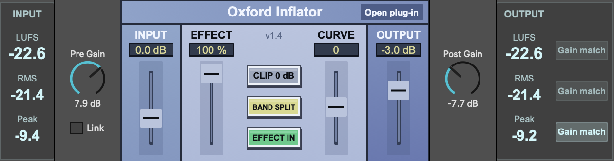

# M4L Wrappers

Control Soundtoys Decapitator, Wavesfactory Spectre and Sonnox Oxford Inflator from Ableton Live’s Device View. Each wrapper adds linked Pre Gain and Post Gain controls, input and output meters, and one-click gain matching by short-term LUFS, RMS or sample peak.

Each v1.4 download contains a single `.amxd`. Install the corresponding licensed VST3 plug-in and open the wrapper in Live with Max for Live. The devices support macOS (Apple Silicon and Intel), with beta support for Windows x64.

## Spectre Wrapper

Drag five colour-coded bands to shape saturation by frequency. Each band has its own saturation type and channel selection.

[Download on Gumroad](https://stephanterning.gumroad.com/l/m4l-spectre-wrapper) · [View on maxforlive.com](https://maxforlive.com/library/device/17391/spectre-wrapper)


## Oxford Inflator Wrapper

Adjust Input, Effect, Curve and Output, and switch Clip 0 dB, Band Split and Effect In directly from the device panel.

[Download on Gumroad](https://stephanterning.gumroad.com/l/m4l-oxfird-inflator-wrapper) · [View on maxforlive.com](https://maxforlive.com/library/device/17392/oxford-inflator-wrapper)



## Decapitator Wrapper

Choose among five saturation styles, push Drive or engage Punish, then shape the sound with the filters and Tone control. Use Mix to blend the processed signal with the dry input.

[Download on Gumroad](https://stephanterning.gumroad.com/l/m4l-decapitator-wrapper) · [View on maxforlive.com](https://maxforlive.com/library/device.php?id=17424)


## Build on macOS

Install Xcode Command Line Tools, Python 3.9 or later and Git. From the repository root:

```sh
mkdir -p deps
git clone https://github.com/steinbergmedia/vst3sdk.git deps/vst3sdk
git -C deps/vst3sdk checkout 3cdf9ca5d1f5b1b21e0a86832aa4abe55607bd96
git -C deps/vst3sdk submodule update --init pluginterfaces base cmake public.sdk
git clone https://github.com/Cycling74/max-sdk-base.git deps/max-sdk-base
git -C deps/max-sdk-base checkout c03a2922a2a8ff149165a1e2ea134e9321d6e202
python3 build.py
```

Existing SDK checkouts can be selected with `VST3_SDK` and `MAX_SDK_BASE`. Run `python3 build.py spectre` or `python3 build.py oxford-inflator` for a single device. Open the resulting file from `dist/` in Live with Max for Live and the corresponding licensed VST3 installed. The Oxford panel draws its own controls by default. A local copy of the original wrapper’s skin can be placed at `devices/oxford-inflator/oxford-surface.png` before building.

## Build for Windows x64 and macOS

The **Build and test wrappers** GitHub Actions workflow compiles and tests both Windows externals on a Windows runner, then packages them with the universal macOS externals. Download the `m4l-wrappers-macos-windows-x64` artifact from a successful run to get the two devices.

To reproduce that build, check out the SDKs pinned above on both machines. On Windows, install Visual Studio 2022 with the Desktop development with C++ workload and CMake 3.25 or later. Run these commands from the repository root.

```powershell
cmake -S windows -B build/windows -G "Visual Studio 17 2022" -A x64
cmake --build build/windows --config Release --parallel
ctest --test-dir build/windows -C Release --output-on-failure
```

Copy the two `.mxe64` files from `build/windows/externals/` to the same directory in the macOS checkout, or download the `windows-externals` artifact from the same revision. On macOS, run

```sh
python3 build.py --windows-externals build/windows/externals
python3 tests/package.py --windows-externals build/windows/externals
```

The resulting devices are in `dist/`. Running the build without `--windows-externals` produces macOS-only devices.

The Windows integration tests use small test plug-ins to exercise discovery after installation, parameter mapping, stereo processing, editor windows, and state recall. Testing the commercial plug-ins in Live on Windows requires a separate installation of Live, Max for Live, and the licensed plug-ins.

## Project layout

Each directory under `devices/` owns its editable Max patch, controller, panel, native host and parameter mapping. The build embeds the controller scripts, UI resources and native Max externals in one .amxd per device.

`shared/` contains VST3 module discovery, audio metering, the meter UI, Drive/Output linking, Gain Match and the missing-plugin warning. The warning groups affected tracks by device type and Live Set. Missing instances pass dry audio. Retry repeats discovery and restores the instance when the plug-in is available. A plug-in that is found but fails to load shows an English load error with the cause.

## Adding a wrapper

Start with the device closest to the new plug-in. Give its external and saved state distinct identifiers. Identify the plug-in by VST3 class ID, map its published parameter IDs, and negotiate its supported sample format and bus layout. Preserve Live parameter identifiers, patch scripting names and the saved-state format so existing Live Sets can recall them. Give a changed native host a new Max class and bundle name for distribution. Max extracts frozen externals by name, and older devices may still have the previous binary loaded or cached. The same built .amxd is used locally and for distribution. Each saved instance restores its own Live parameters and plug-in state. Test an update by saving distinct settings in two instances of the previous version, replacing the device file at the same path and reopening the Set.

Run the controller and package checks after building (Node.js required):

```sh
node tests/oxford.cjs
node tests/spectre.cjs
```

Before releasing a wrapper, check save/reload, missing-plugin recovery and parameter automation in Live. Compare CPU and sample alignment with the native plug-in using identical audio, settings and buffer size, including modes that change latency.
