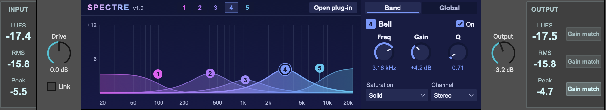

# M4L Wrappers

Control Soundtoys Decapitator, Wavesfactory Spectre and Sonnox Oxford Inflator from Ableton Live’s Device View. Each wrapper adds linked Pre Gain and Post Gain controls, input and output meters, and one-click gain matching by short-term LUFS, RMS or sample peak.

Each v1.4 download contains a single `.amxd`. Install the corresponding licensed VST3 plug-in and open the wrapper in Live with Max for Live. The devices support macOS (Apple Silicon and Intel), with beta support for Windows x64.

## Spectre Wrapper

Drag five colour-coded bands to shape saturation by frequency. Each band has its own saturation type and channel selection.

[Download on Gumroad](https://stephanterning.gumroad.com/l/m4l-spectre-wrapper) · [View on maxforlive.com](https://maxforlive.com/library/device/17391/spectre-wrapper)



## Oxford Inflator Wrapper

Adjust Input, Effect, Curve and Output, and switch Clip 0 dB, Band Split and Effect In directly from the device panel.

[Download on Gumroad](https://stephanterning.gumroad.com/l/m4l-oxfird-inflator-wrapper) · [View on maxforlive.com](https://maxforlive.com/library/device/17392/oxford-inflator-wrapper)


## Decapitator Wrapper

Choose among five saturation styles, push Drive or engage Punish, then shape the sound with the filters and Tone control. Use Mix to blend the processed signal with the dry input.

[Download on Gumroad](https://stephanterning.gumroad.com/l/m4l-decapitator-wrapper) · [View on maxforlive.com](https://maxforlive.com/library/device.php?id=17424)


## How the wrappers work

All three devices load the installed VST3 by name through Max’s `vst~`. The shared adapter maps parameters, restores the plug-in state stored in the Live Set and forwards latency changes. If loading fails, the wrapper lists the affected tracks and passes the original stereo input through at unity gain. After restoring the VST3 installation, restart Live and reopen the Set to recall its saved state.

The source build uses embedded Max `gen~` patches for the 5 ms gain ramps and the three-second stereo meters. Max generates the audio code on the user’s machine. Each source build produces one device file for macOS and Windows. The published v1.4 downloads used a compiled gain and meter external.

A Max for Live license supports playback of devices with embedded Gen. Editing and saving the Gen patch in the Max editor requires a standalone Max license. [Cycling ’74 on Max for Live licensing](https://docs.cycling74.com/userguide/m4l/live_limitations/)

## Build from source

Run this command from the repository root with Python 3.9 or later. It builds all three standalone devices in `dist/` using only the Python standard library.

```sh
python3 build.py
```

On Windows, use `py -3 build.py`. To build one device, pass `decapitator`, `spectre` or `oxford-inflator`. Use `--output DIR` to select a different output directory. Ableton Live, Max for Live and the licensed VST3 are needed to play and test the device.

## Development and verification

The Max host adapter and shared audio code live in `host/`. Each wrapper’s controls, panel and configuration live under `devices/`. The common meter UI, gain linking, gain matching and missing-plug-in warnings live in `shared/`.

When adding or updating a wrapper, preserve its Live parameter identifiers and per-instance plug-in state. Test recall by saving two differently configured instances in the previous version and reopening the Set after replacing the device at the same path. Also check automation, missing-plug-in recovery, CPU time and sample alignment against the VST3 loaded directly in Live. Include modes that change latency.

Run the archive, adapter and controller checks from the repository root. These checks also run in GitHub Actions.

```sh
python3 tests/package.py dist
node tests/max-host/adapter.cjs
node tests/oxford.cjs
node tests/spectre.cjs "dist/Spectre Wrapper.amxd"
```

The portable DSP also has acoustic tests that run with a local installation of Max. The verification notes include the gain-ramp, metering, audio, recall and CPU comparisons. [Portable audio verification](tests/portable/verification.md)
